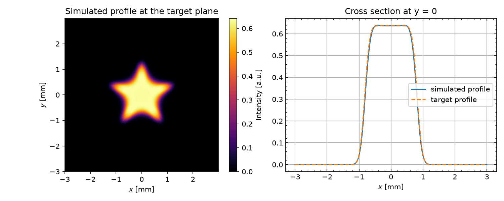
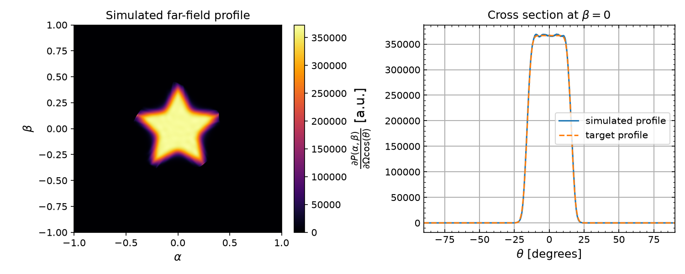
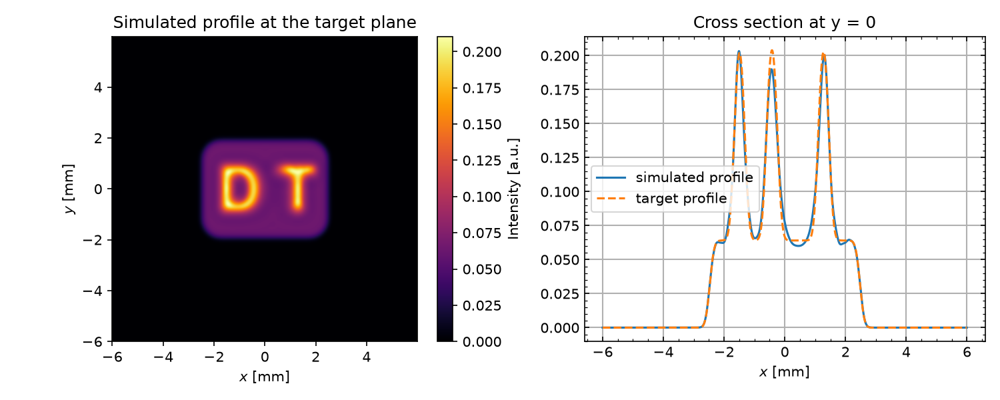
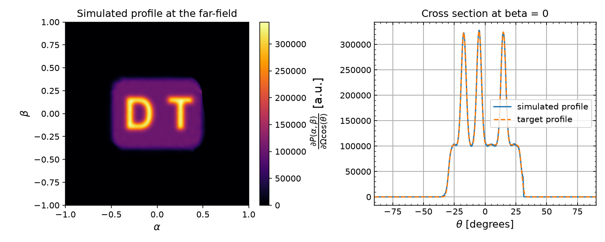
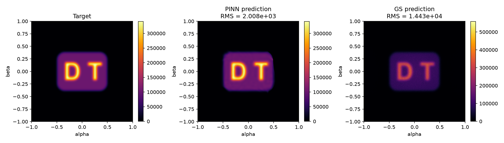
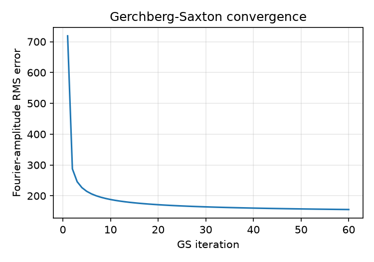

# PINN Beam Shaping — 本机复现版 (pinn-shaper)

[](https://doi.org/10.48550/arXiv.2607.18012)

本仓是 [rafael-fuente/pinn-shaper](https://github.com/rafael-fuente/pinn-shaper) 的复现分支：
在**本机从零训练**了论文的全部 4 个实验，用 `diffractsim` 做标量衍射校验，并新增了一个
与 Gerchberg–Saxton (GS) **同接口**的相位生成函数 `pinn_shaping()` 和一键训练脚本
`train_all.py`。所有数字都来自本仓 `results/`、`reproduced_models/` 里的实际产物，
不是论文原值。

> 本机环境：Ubuntu / 2× RTX 4090（训练时每卡仅剩约 5 GB 空闲显存，因此默认把
> `integration_points` 从论文的 5000 降到 1500 也能收敛）/ Python 3.11 venv
> (`/home/ws/pinn-venv`)、`torch 2.11.0+cu128`、`diffractsim 2.2.13`、`jax 0.11.1`。
> 单卡训练每个实验约 3–5 分钟。

---

## 1. 本机实测结果

四个实验均为**从零训练**（未使用仓内 `saved_models/` 官方权重），校验用
`diffractsim` CPU 后端、2048×2048 网格。完整报告与全部插图见 [`report.md`](report.md)。

| 实验 | 目标图案 | 目标面 | 关键指标（本机实测） | 论文 |
|---|---|---|---|---|
| Exp1 | 六角星平顶 | 近场 z = 10 cm | 截面 rel-RMS **2.45%** | — |
| Exp2 | 六角星平顶 | 远场 | 截面 rel-RMS **0.76%** | — |
| Exp3 | "DT" 字母平顶 | 近场 6 → 10 mm | 截面 rel-RMS **5.38%** | — |
| Exp4 | "DT" 字母 | 远场 | PINN MSE **4.033×10⁶**, rel-RMS **3.15%**, η **99.96%** | 3.59×10⁶ / 2.97% / 99.98% |
| Exp4 | 同上，GS 对照 | 远场 | GS MSE **2.081×10⁸**, rel-RMS **22.61%**, η **95.90%** | 2.08×10⁸ / 22.6% / 95.90% |

论文的核心结论在本机复现成功：远场 "DT" 目标上 PINN 的 MSE 比 GS **低约 52 倍**
（4.03×10⁶ vs 2.08×10⁸），目标区能量效率 99.96% vs 95.90%。

使用仓内**官方预训练权重**跑 `repro/exp4_paper_check.py`，可精确复现论文数值：

| 模型 | MSE | rel-RMS | η |
|---|---|---|---|
| PINN（官方权重） | **3.590469×10⁶** | **2.97%** | **99.982%** |
| GS | **2.081097×10⁸** | **22.61%** | **95.898%** |

训练结束时各实验的最终 PDE 测试损失：Exp1 `2.1595e-4`、Exp2 `8.69e-6`、
Exp3 `5.9489e-4`、Exp4 `1.409e-5`。

### 复现图

| Exp1 星形（近场） | Exp2 星形（远场） |
|---|---|
|  |  |

| Exp3 DT 字母（近场） | Exp4 DT 字母（远场，PINN vs GS） |
|---|---|
|  |  |

| Exp4 形状误差对比 | Exp4 GS 收敛 |
|---|---|
|  |  |

---

## 2. 一键训练

```bash
# 训练全部 4 个实验（已有 checkpoint 时自动复用，只做评估）
python train_all.py

# 只跑部分实验 / 强制重训 / 指定 GPU 与随机种子
python train_all.py --only exp1 exp3
python train_all.py --force --seed 1 --gpu 0

# 无 GPU 时（会显著变慢）
python train_all.py --device cpu --only exp1

# 用官方权重做论文数值校验
python train_all.py --paper-check

# 看看会执行什么
python train_all.py --list
python train_all.py --dry-run
```

脚本默认按 `exp1 → exp2 → exp3 → exp4` 串行执行（显存有限，避免并发 OOM），
每个实验的输出同时打印到终端并写入 `results/train_<key>.log`，最后汇总为
`results/train_summary.json` 与控制台表格。退出码非 0 表示有实验失败。

单独运行某个实验：

```bash
python repro/exp1_star_nearfield.py --seed 0            # 从零训练
python repro/exp1_star_nearfield.py --no-train          # 复用 reproduced_models/
```

| 脚本 | 内容 | 产物 |
|---|---|---|
| `repro/exp1_star_nearfield.py` | 星形平顶 / 近场 | `reproduced_models/star_flat-top-nearfield_model.pth`、`results/exp1_*.png` |
| `repro/exp2_star_farfield.py` | 星形平顶 / 远场 | `reproduced_models/star_flat-top-farfield_model.pth`、`results/exp2_*.png` |
| `repro/exp3_dt_nearfield.py` | DT 字母 / 近场 | `reproduced_models/DT_flat-top-nearfield_model.pth`、`results/exp3_*.png` |
| `repro/exp4_dt_farfield_gs.py` | DT 字母 / 远场 + GS 对照 | `reproduced_models/DT_flat-top-farfield_model.pth`、`results/exp4_*.png` |
| `repro/exp4_paper_check.py` | 官方权重数值校验 | `results/exp4_paper_check.png` |

---

## 3. 与 Gerchberg–Saxton 同接口的相位生成

`pinn_shaper.shaping.pinn_shaping()` 的参数名、默认值语义和返回字段都对齐
AO-shaping 的 `gerchberg_saxton()`，凡是用 GS 产生整形相位的下游代码可以原样替换。

```python
import numpy as np
from pinn_shaper import pinn_shaping

# source_amplitude / target_amplitude 都是"振幅"（强度的平方根），形状必须相同且为方形
res = pinn_shaping(
    source_amplitude=source_amp,      # (N, N)
    target_amplitude=target_amp,      # (N, N)
    iterations=3000,                  # Adam 步数（GS 里是 GS 循环次数）
    cell_spacing=8e-6,                # 像素间距 [m] —— 分辨率对齐的关键
    distance=0.1,                     # 传播距离 [m]，propagation="asm" 时使用
    wavelength=1064e-9,
    propagation="asm",                # "asm" 近场 / "fft" 远场
)

phase = res.phase                     # (N, N) 弧度，可直接下发 SLM
print(res.rel_rms, res.efficiency, res.iterations, res.converged)
```

与 GS 并排使用时：

```python
from ao_shaping.algorithm.signal_processing.gerchberg_saxton import gerchberg_saxton
gs = gerchberg_saxton(source_amp, target_amp, iterations=50,
                      cell_spacing=8e-6, distance=0.1, wavelength=1064e-9)
assert gs.phase.shape == res.phase.shape          # 同一网格，可互换
```

### 返回对象

`PINNShapingResult` 与 `GSResult` 同名字段：`phase`、`amplitude`、`error_history`
（每次评估点的 MSE）、`iterations`、`converged`；另加：

| 字段 | 含义 |
|---|---|
| `mse` | 最终 MSE，定义与 GS 一致：`mean((|C| − target)²)`（受绝对幅度尺度影响） |
| `rel_rms` | 最小二乘重标定后的相对 RMS，**跨模式/跨尺度可比，推荐用它** |
| `efficiency` | 目标支撑域（`target ≥ 0.5·max`）内能量 / 源面总能量，即论文的 η |
| `solver` | 训练好的 PINN 实例，可继续训练或 `get_phi_spline()` 采样条 |
| `target_amplitude` | 传入的目标振幅，便于画对比图 |

其它可用参数：`error_threshold`、`progress_callback(iter, mse)`、
`phase_callback(iter, phase)`、`hidden_layers`、`num_features`、`phi_scale`、
`symmetry`、`constrain/constrain_fn`、`integration_points`、`lr`、
`lbfgs_iterations`、`device`、`seed` 等。

### 分辨率对齐（重要）

GS 用像素网格 + `cell_spacing` 定义物理/角域，本接口沿用同一套约定，并据此把
像素数组映射到 PINN 的连续坐标：

| 量 | 约定 |
|---|---|
| 源面物理尺寸 | `extent_source = N · cell_spacing`（`N = source_amplitude.shape[0]`） |
| 像素坐标 | `x_i = (i − (N−1)/2) · cell_spacing`（对称、中心在像素中心） |
| 近场 `propagation="asm"` | 角谱不改变网格，`extent_target = extent_source`，目标面与源面**同分辨率** |
| 远场 `propagation="fft"` | 奈奎斯特方向余弦 `α_max = min(λ / (2·cell_spacing), 1.0)`；目标振幅的 `N×N` 像素线性铺满 `α, β ∈ [−α_max, α_max]` |

`α_max` 这一行是远场对齐的关键：它保证 PINN 训练用的 `(α, β)` 采样域与
`fft2` / `diffractsim.get_farfield()` 的采样域逐点一致；当源网格比 `λ/2` 更细时
截断到物理极限 `sin θ ≤ 1`。

远场请确保目标的角度范围落在 `α_max` 以内，即
`cell_spacing ≤ λ / (2·max|α_target|)`；超出 `α_max` 的部分会被 FFT 采样混叠，
物理上不可实现。

注意事项：

- PINN 的解定义在方形归一化域 `[-M, M]²` 上，因此要求 **`Ny == Nx`**；GS 允许矩形，PINN 不支持（会 `ValueError`）。目标图分辨率不同时请先重采样到 `N×N`。
- 接口收的是**振幅**；内部按 `I = amplitude²` 转成强度，与论文的 `I_fun / E_fun / Irad_fun` 一致。
- 近场 `propagation="asm"` 默认 `phi_scale=30`、远场 `"fft"` 默认 `phi_scale=8`（论文取值）；远场星形目标常用的硬约束可用 `constrain=True, constrain_fn=lambda p: p[:,0:1]**2 + p[:,1:2]**2`。
- 远场 `"fft"` 分支用酉变换（`fft2/√(N²)`）保持 Parseval 能量守恒，其 `amplitude` 与 `mse` 是酉变换单位下的量；**比较质量请用 `rel_rms`**。
- 只跑少量 Adam 步（如 60 步）时相位几乎不动是正常现象：论文需要约 3000 步 Adam + 数千步 L-BFGS。`train_all.py` 里的训练日程即论文日程。
- 默认参数（3000 步 Adam、1500 个配点）是"可用"档；要接近论文质量请用
  `iterations=3000, num_domain=15000, num_boundary=1000, integration_points=5000, lbfgs_iterations=2000`，或直接跑 `train_all.py`。

---

## 4. 环境与安装

```bash
git clone git@github.com:ywzhang909/pinn-shaper.git
cd pinn-shaper
python -m venv .venv && . .venv/bin/activate
pip install torch            # CUDA 版请按官网选择对应 wheel
pip install diffractsim jax scipy matplotlib pillow numpy
```

主要依赖：`torch`、`diffractsim`（标量衍射校验）、`jax`（diffractsim 后端）、
`numpy`、`scipy`、`matplotlib`、`pillow`。`pinn_shaping()` 本身只依赖
`torch` + `numpy`，不依赖 `diffractsim`，可以在纯 CPU 环境跑通接口级测试。

---

## 5. 仓库结构

```
pinn_shaper/            核心包
├── nearfield_shaper.py   Nearfield_PINN（有限距离整形）
├── farfield_shaper.py    Farfield_PINN（远场整形）
├── shaping.py            pinn_shaping() / PINNShapingResult / evaluate_shaping()
├── fcnn.py               带可选硬约束的全连接网络
└── util.py               插值器、图像加载、单位常量
repro/                  4 个实验 + 官方权重校验脚本
reproduced_models/      本机从零训练得到的 4 个 .pth
saved_models/           上游官方预训练权重（用于论文数值校验）
results/                所有复现图 + 训练日志 + train_summary.json
train_all.py            一键训练/评估脚本
report.md               完整复现报告
images/                 目标图案（star.png / DT.png）与示意图
```

## 6. 方法要点

- 把整形问题写成非线性 Monge–Ampère 型 PDE，用 PINN 的相位势 `Φ(x, y)` 求稳态解；
- 能量守恒通过 PDE 残差隐式施加，源/目标功率由积分自动归一化；
- 支持非傍轴广义 Snell 光线映射；
- 一阶/二阶相位导数全部由自动微分得到；
- 与 GS 相比，PINN 相位更平滑、散斑更少、能量更集中（见上表）。

## 7. Citation

If you use `pinn-shaper` in your research, please cite the paper:

R. de la Fuente Herrezuelo, <i>Physics-Informed Neural Networks for Optimal Beam Shaping in Flat Optics</i> (2026), https://doi.org/10.48550/arXiv.2607.18012.
